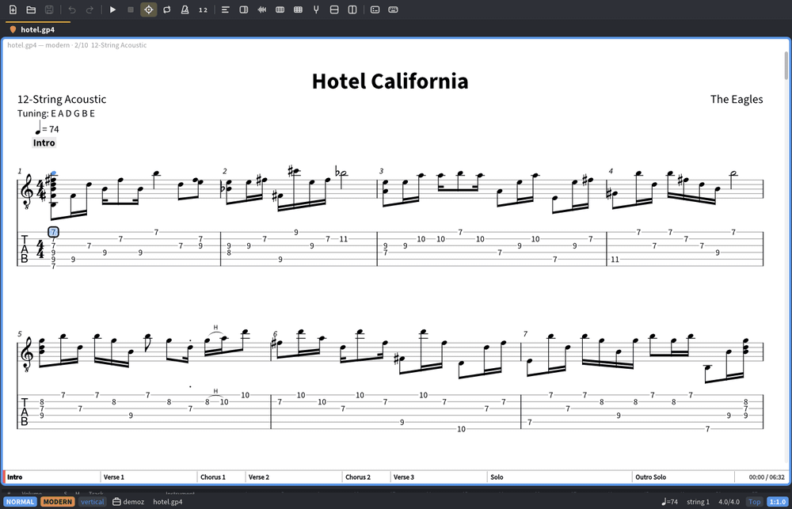

<p align="center"></p>

# cecilia

**A keyboard-first editor and player for guitar tab, standard notation and Gregorian chant.**
Open Guitar Pro files, play along with a recording, and edit square-note chant in a real
WYSIWYG editor. Free and open source, written in Rust, with a window _and_ a terminal interface.



> [!WARNING]
> **cecilia is still in development.** Until version 1.0.0, features, key bindings, commands,
> config options and the native file formats (`.ccc`, `.ccm`) can change in breaking ways between
> releases. Keep your scores in a standard format too (Guitar Pro, MusicXML, GABC) and read the
> [changelog](CHANGELOG.md) before upgrading.

## Why cecilia

- **Chant is a first-class citizen.** A WYSIWYG square-notation editor, not a text file and a
  typesetter: see [below](#wysiwyg-chant-editor).
- **Guitar Pro in, Guitar Pro out.** Reads GP3–GP8 and writes GP5, GPX and GP7/8, so you are not
  locked in either direction.
- **Play along with the real recording.** Sync an mp3/flac/ogg/m4a to the score and practise
  with loops, speed and pitch control.
- **Everything from the keyboard**, vim-style, in the window and in the terminal, with the same
  key bindings in both.
- **Free, open source, and scriptable** from the command line (convert, engrave, inspect).

## Features

**Notation and engraving**

- Guitar tablature, standard notation, slash notation, drums (standard drum notation and
  CY/HH/SN/BD drum tab) and piano grand staves; up to four voices per bar
- Lyrics with several verses, hyphenation and repeats; markers, sections and repeats
  (D.C./D.S.), tuplets, ties, and most Guitar Pro techniques (bends, slides, hammer-ons,
  harmonics, palm mute, …), auto-fingering and retuning
- Gregorian chant in square notation: neumes, clefs, divisions, custodes, episemata, morae, drop
  cap initial; equalist or Solesmes rhythm
- Page, continuous-vertical and continuous-horizontal layouts, zoom, split panes

**Playback and practice**

- MIDI playback with a moving cursor, through a SoundFont (`.sf2`) or a built-in synth
- Audio play-along: attach a recording (or use the one embedded in a GP7/8 file), sync it by
  tapping bars or with beat detection, and play it alone or mixed with the MIDI at any speed or
  pitch
- A–B loops, speed trainer, metronome and count-in; a waveform strip with sync points
- Fretboard and piano views that light up the notes at the cursor; a built-in tuner
- A tracks panel with volume, solo, mute and instrument per track

**Editing**

- Vim-style Normal / Insert / Visual modes, operators and counts, macros, marks and an undo
  _tree_
- Command line (`:`), command palette, pickers for files, buffers and workspaces, a which-key
  hint popup, mouse support
- Workspaces: views, pane splits and open files are remembered between sessions
- Themes (15 built-in presets, or your own) and TOML configuration with custom key bindings,
  reloaded as you save

**Interfaces**

- **GUI**: a GPU-rendered window (wgpu/vello) with engraved notation and click-to-place cursor
- **TUI**: a terminal interface with tablature view and basic editing, which also works over SSH

**Files and export**

- From the command line (`cecilia convert`): PDF, SVG and PNG export of engraved notation; WAV/FLAC
  export of the MIDI rendering mixed with the recording; MIDI, MusicXML and GABC output

## Where cecilia fits

cecilia is young and pre-1.0. Its focus is chant and tab in one keyboard-driven tool, and
practising with a recording from a terminal or a plain window. What it does and does not do today:

- Reads Guitar Pro 3-5 (`.gp3`-`.gp5`) and 6-8 (`.gpx`, `.gp`); writes GP5, GPX and GP7/8.
- Reads and writes MusicXML, MIDI and GABC (Gregorio), plus its own `.ccc` / `.ccm` files.
- Sounds: a SoundFont (`.sf2`) you provide, or a basic built-in synth. No SoundFont is bundled.
- Platforms: Linux is the tested platform; macOS and Windows build from source but are untested.
- Not there yet: binary releases, distribution packages, a plugin or scripting interface, and
  the polish and community of older programs such as Guitar Pro, MuseScore or TuxGuitar.

## WYSIWYG chant editor

Most chant workflows mean writing GABC text and compiling it with a typesetter to see the result.
cecilia edits the engraved chant directly: what you see on the page is the score you are editing.

- Square notation is drawn as you work, in the Caeciliae font: neumes, clefs, divisions,
  custodes, episemata, morae, liquescents, flats and the drop-cap initial
- Click to place the cursor on a note or syllable, move with the same keys as everywhere else,
  and change pitches, note shapes, clefs and divisions with a few keystrokes (`tc3` for a do
  clef on line 3, `td:` for a division); a palette lists them for the mouse
- Edits are undoable, in an undo tree, and play back straight away
- Plain GABC stays the interchange format: open `.gabc` from GregoBase or Gregorio, and save
  `.gabc` back; `:gabc` edits the raw source when
  you want it
- Sync a chant to a recording by tapping syllable by syllable (automatic detection for chant is not done yet)
- Convert between modern notation and chant (`:modern-to-chant`, `:chant-to-modern`)
- Export square notation to PDF, SVG or PNG (`cecilia convert chant.gabc chant.pdf`)

In the terminal, chant is shown as a text staff (the engraved view needs the GUI). See
[docs/CHANT.md](docs/CHANT.md).

## Installation

cecilia is not packaged yet: the repository has version tags only, no binary releases or
distribution packages, so for now you build it from source. You need a [Rust toolchain](https://rustup.rs) (1.88 or newer) and git.

```sh
git clone https://github.com/kjmcnamara1/cecilia.git && cd cecilia
```

### Linux

Building needs a C compiler, `pkg-config` and the ALSA development files (the window system libraries are loaded at run time):

| Distribution    | Packages                                                     |
| --------------- | ------------------------------------------------------------ |
| Debian / Ubuntu | `sudo apt install build-essential pkg-config libasound2-dev` |
| Fedora          | `sudo dnf install gcc pkgconf-pkg-config alsa-lib-devel`     |
| Arch            | `sudo pacman -S base-devel alsa-lib`                         |

Then run the installer, which builds cecilia and adds a desktop entry, icon and file types so
file managers offer it for Guitar Pro, GABC and cecilia files:

```sh
packaging/linux/install.sh                   # into ~/.local (make sure ~/.local/bin is on PATH)
sudo packaging/linux/install.sh /usr/local   # system-wide
packaging/linux/uninstall.sh [PREFIX]        # remove it again
```

A Vulkan- or OpenGL-capable graphics driver is needed for the window (`--gui`).

### macOS and Windows

Packaged builds do not exist yet, and these platforms are not tested by the author. In principle
the same build works:

```sh
cargo install --locked --path crates/cecilia
```

This puts `cecilia` on your `PATH` (in `~/.cargo/bin`). There is no installer, file association
or desktop entry; run `cecilia --gui song.gp5` from a terminal. Bug reports from these platforms
are welcome. The terminal interface needs a modern terminal; on Windows use Windows Terminal.

### Just try it

```sh
cargo run --release -- --gui song.gp5
```

## Usage

```sh
cecilia song.gp5            # open in the terminal UI
cecilia --gui song.gp5      # open in a window
cecilia                     # reopen your last workspace
cecilia -W practice a.gp5   # open files in a named workspace
```

The window needs `--gui`; without it you get the terminal UI. Command-line tools:

```sh
cecilia info song.gp5                                 # tracks, tunings, tempo, length (--json)
cecilia play song.gp5                                 # headless playback
cecilia convert in.gpx out.musicxml                   # convert; the output extension picks the format
cecilia convert song.gp5 song.pdf --track 2 --layout page   # engrave to PDF / SVG / PNG
cecilia convert song.gp song.flac                     # render MIDI + recording to audio
cecilia convert hymn.gp5 hymn.gabc                    # melody and lyrics as chant (lossy)
cecilia convert chant.gabc chant.pdf                  # square notation
```

### First steps in the editor

| keys                            | what it does                                                        |
| ------------------------------- | ------------------------------------------------------------------- |
| `h` `j` `k` `l`                 | move by beat and string (`j` / `k` between staff lines in notation) |
| `w` `b`, `{` `}`                | next / previous note, previous / next bar                           |
| `J` `K`                         | next / previous track                                               |
| `Space Space`, `Space s`        | play / pause, stop                                                  |
| `Space v`                       | cycle page / vertical / horizontal layout                           |
| `Space T`, `Space F`, `Space K` | tracks panel, fretboard, piano                                      |
| `i`                             | Insert mode: type fret numbers, `Esc` to leave                      |
| `u`, `U`                        | undo, redo (`g-` / `g+` walk the undo tree)                         |
| `Ctrl-=` `Ctrl--`               | zoom                                                                |
| `<C-w>s` `<C-w>v`               | split the pane                                                      |
| `:`                             | command line, e.g. `:w song.gp5`, `:q`                              |
| `F1` or `Space ?`               | every key binding, searchable                                       |

`Space` is the leader key. Open a chant with `cecilia chant.gabc --gui` and use `t` followed by
a letter for note shapes, clefs and divisions (see [docs/keymap.md](docs/keymap.md)).

To practise with a recording: open the score, attach the audio file (`:audio recording.mp3`), tap the bars in Sync mode (`S`) or run `:sync-detect`, then play with
`Space Space`; `Space l` loops the bars you select, `Space -` / `Space =` change the speed.

## Configuration

On Linux, `~/.config/cecilia/config.toml` (`$XDG_CONFIG_HOME/cecilia/`; other platforms use their
standard config directory, or pass `--config`); see [docs/config.example.toml](docs/config.example.toml) for
every option, and [docs/keymap.md](docs/keymap.md) for key bindings (all can be overridden). For
realistic instrument sounds set `audio.soundfont` to a General MIDI `.sf2` file (for example
FluidR3_GM or GeneralUser GS); otherwise the built-in synth is used.

## Documentation

- [docs/keymap.md](docs/keymap.md): every key binding and command
- [docs/CHANT.md](docs/CHANT.md): chant model and conversion
- [docs/LYRICS.md](docs/LYRICS.md): lyrics
- [docs/SPEC.md](docs/SPEC.md): specification, file formats and roadmap
- [CHANGELOG.md](CHANGELOG.md) and [TODO.md](TODO.md): what changed and what is planned

## Contributing and development

```sh
cargo test --workspace
cargo clippy --workspace --all-targets -- -D warnings
```

Format tests also parse every Guitar Pro file under `test-corpus/` (gitignored; point it at your
own collection, e.g. `ln -s ~/Music/Tabs test-corpus`). Architecture notes for contributors are
in [AGENTS.md](AGENTS.md).

## Fonts

Bundled under the SIL Open Font License 1.1 (texts in `assets/fonts/`): Bravura (music symbols),
Source Sans 3 (text), Noto Serif (the lyrics of chant scores by default, and the versicle,
response, dagger and barred A in any font) and Caeciliae by the Oblates of St. Joseph (square
chant notation).

## License

Licensed under either of [Apache License 2.0](LICENSE-APACHE) or [MIT](LICENSE-MIT) at your
option.
