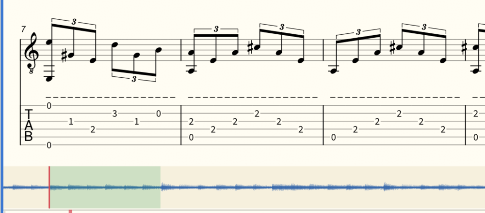

# Playing along

cecilia can play a score together with the real recording, so you can practise against the band
rather than a MIDI rendering. You sync the recording to the score once, then loop, slow down and
transpose it as you practise.



## 1. Attach a recording

Open the score, then attach an mp3, m4a/aac, flac, ogg or wav file:

```text
:audio recording.mp3
```

With no file name, cecilia picks the best match next to the score or in an `mp3/` or `audio/`
folder beside it. Guitar Pro 7 and 8 files that carry their own recording use it straight away.

## 2. Sync it to the score

The recording has to know where each bar starts. Press `S` to enter **Sync mode** (or run
`:sync`). The waveform opens under the score with the sync points marked.

- **Tap it in:** press `Space` to play, and `Enter` on each beat as you hear it. The cursor moves
  on after each tap. `u` takes the last tap back.
- **Let cecilia find the beats:** tap the first downbeat, then run `:sync-detect`. It fills in the
  rest by beat detection, which you can correct by hand.
- **Fine-tune:** `[` `]` move the sync point under the cursor by 10 ms, `{` `}` by 50 ms.

Press `Esc` to leave Sync mode. Sync points are saved with the score (`.ccc` / `.ccm` files keep
them per beat; Guitar Pro files keep one per bar).

## 3. Practise

| keys / command              | what it does                                                    |
| --------------------------- | --------------------------------------------------------------- |
| `Space Space`               | play / pause                                                    |
| `Space l`                   | loop the selected bars (or the cursor's bar); again to stop     |
| `:loop 9 16`                | loop bars 9 to 16                                               |
| `Space -` / `Space =`       | speed down / up by 5%, without changing the pitch               |
| `:trainer 60 100 5`         | start at 60% and get 5% faster each loop, up to 100%            |
| `:pitch -2`                 | shift the recording down two semitones, keeping the tempo       |
| `Space a`                   | play the recording and the MIDI, the recording only, or the MIDI only |
| `Space m`, `Space c`        | metronome, count-in                                             |
| `:volume audio 80`          | set the level of the recording (also `midi`, `metronome`, `master`) |

The [tracks panel](keymap.md) (`Space T`) has a row for the recording, with its own volume, mute and
solo, so you can drop out the MIDI guitar and play that part yourself.

## Chant recordings

Chant is synced syllable by syllable rather than by beats. `:sync-detect` on a chant follows the
pitches sung in the recording. See [Chant](CHANT.md).

## Rendering to audio

To export the score mixed with its recording:

```sh
cecilia convert song.gp song.flac
```
